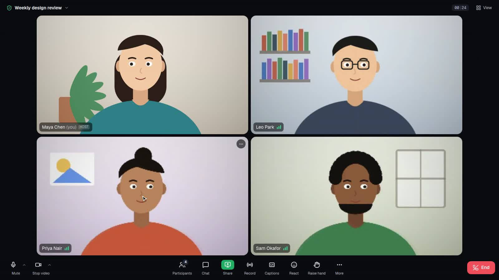
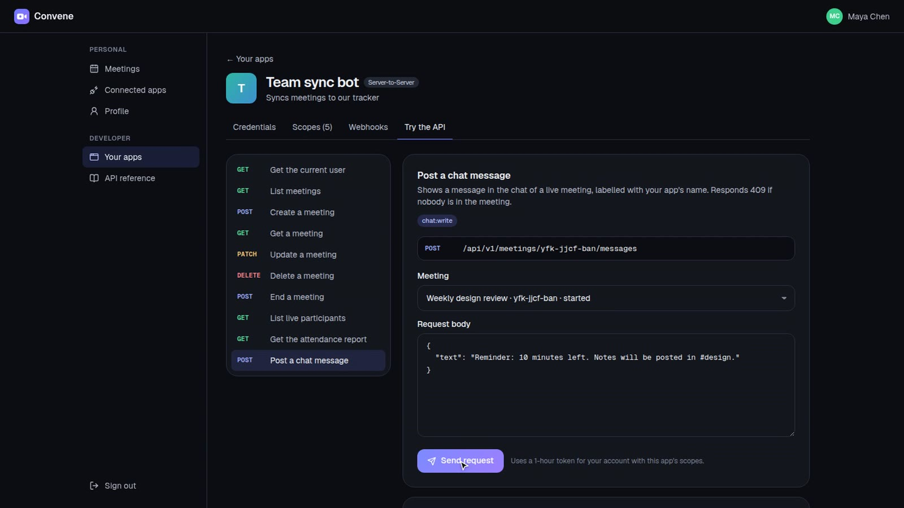
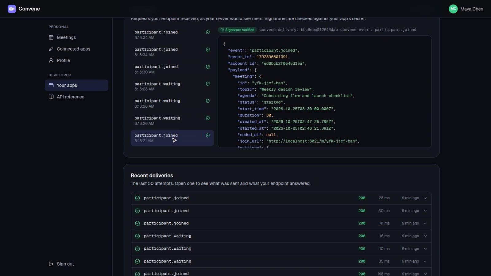
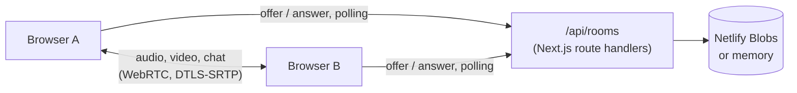
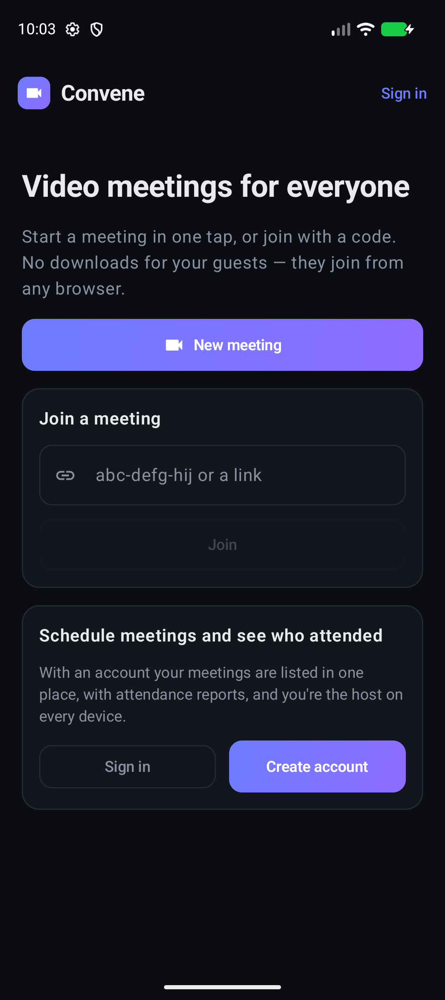

<div align="center">


# Convene

**Open-source video meetings that open in a browser tab, with a developer platform: a REST API, OAuth 2.0 apps with scopes, and signed webhooks. No app to install, no account needed to join, and no media server.**

[](LICENSE)
[](https://nextjs.org)
[](https://webrtc.org)

**Live:** <https://convene-meet.netlify.app> · [Developer docs](https://convene-meet.netlify.app/developers/docs) ·
[Android app](https://github.com/amanjhacodes55/convene/releases/tag/android-v1.0.0) ·
[**Watch the demo video (4 min)**](docs/media/convene-demo.mp4)

[](docs/media/convene-demo.mp4)

</div>

Zoom, Webex and Teams need an app, an account, or both. Convene is a meeting link: start a meeting, send the
link, and everyone talks in their browser. It is free to use, change and host under the MIT License.

## Features

- **Video and audio**: up to 720p video, echo cancellation, noise suppression and automatic gain, with a
  connection-quality indicator on every tile.
- **Lobby**: preview your camera, watch your microphone level and pick your camera, microphone and speakers
  before you join.
- **Gallery and speaker views**: tiles keep their 16:9 shape at any window size; the person talking gets a
  green outline, and speaker view follows them. Pin anyone to keep them on the stage.
- **Screen sharing** that takes the stage for everyone, with the presenter's camera in the strip beside it.
- **Chat** with clickable links, **reactions**, and **raise hand**.
- **Host controls**: waiting room with admit, deny and admit all; mute one person or everyone; lower hands;
  remove someone; lock the meeting; end it for everyone.
- **Record to this computer**: every tile and every voice, mixed into a WebM file. Nothing is uploaded, and
  everyone sees a recording badge while it runs.
- **A desktop-app control bar**: mute and camera buttons with device menus, Participants, Chat, a green Share
  button, Record, Captions and Reactions, a meeting-info panel (ID, host, invite link, encryption), and a View
  menu with speaker and gallery layouts, hide self view and full screen.
- **Live captions**: each speaker's own browser transcribes their microphone (Web Speech API) and sends the
  text to whoever has captions on. Audio never goes anywhere new.
- **Spotlight** someone for everyone (host), or pin them just for you; **private chat** to one person; tile
  menus for pin, spotlight, message, mute and remove.
- **Zoom-style details**: hold **Space** to talk while muted, a "you're muted" hint when you start talking,
  soft join and leave chimes, and an **Admit** button right in the waiting-room notice.
- Keyboard: **M** mute, **V** camera, **H** hand, **C** chat, **P** participants, **?** for the list.

### Meeting controls, as in Zoom's paid plans

- **Registration**: attendees register with name, email and phone; approve them automatically or one by
  one. Each gets a personal join link, and the host can export registrants as CSV.
- **Passcodes** (included in invitations and links) and **sign-in-only** meetings, so you know who joined.
- **Attendee tracking**: hosts see each participant's email and phone in the call, and the attendance
  report records them with join and leave times.
- **A Security menu** for hosts: lock, waiting room, hide the participant count, hide the participant list
  (attendees see only the hosts), who may chat (everyone, host only, off), who may share their screen,
  whether participants may unmute themselves, and muting people as they join.
- **Co-hosts**, and **polls** with live results that the host shares when the poll ends.

### With a free account

- **Meetings dashboard**: schedule meetings with a topic, time, duration and agenda; copy a ready-made
  invitation; start or join with one click. Your meetings recognise you as host on any device.
- **Attendance reports**: who joined, when they left and for how long, with CSV export, plus a live roster
  while the meeting is on.
- **Connected apps**: see which apps can use your account and remove their access.

### Developer platform

Like the Zoom, Webex and Teams developer platforms, scaled to what a meeting app needs:

- **REST API** at `/api/v1`: create, list, update, delete and end meetings; live participants and the waiting
  room; attendance reports; and posting messages into a live meeting's chat as your app.
- **OAuth 2.0**: *OAuth apps* use the authorization-code grant with PKCE, a consent screen that lists each
  scope, and rotating refresh tokens. *Server-to-Server apps* use client credentials. Tokens and secrets are
  stored only as SHA-256 hashes; removing an app revokes every token it holds.
- **Scopes**: `user:read`, `meeting:read`, `meeting:write`, `participant:read`, `chat:write`, checked on
  every endpoint (`403 insufficient_scope` otherwise).
- **Webhooks**: `meeting.created/updated/deleted/started/ended`, `participant.joined/left/waiting` and
  `meeting.registration_created/approved/denied`, signed
  with HMAC-SHA256 (`Convene-Signature: t=…,v1=…`), with a delivery log, redelivery, a test event, and a
  **built-in test inbox** that checks signatures, so you can try webhooks without running a server.
- **Developer portal**: create apps, manage credentials, redirect URIs, scopes and webhooks, walk through
  the install flow, and an **API playground** that sends real requests and shows the cURL.
- **Docs** at [/developers/docs](https://convene-meet.netlify.app/developers/docs).

| API playground | Webhooks in the test inbox |
| --- | --- |
|  |  |

```bash
# A server-to-server app: get a token, then schedule a meeting.
curl -X POST https://convene-meet.netlify.app/oauth/token -u "$CLIENT_ID:$CLIENT_SECRET" -d grant_type=client_credentials
curl -X POST https://convene-meet.netlify.app/api/v1/meetings \
  -H "Authorization: Bearer $ACCESS_TOKEN" -H "Content-Type: application/json" \
  -d '{"topic":"Onboarding call","start_time":"2026-11-02T15:00:00Z","duration":30}'
```

## How it works



- **Media is peer to peer.** Every participant connects directly to every other one (a mesh), so there is no
  media server to run or pay for. That suits meetings of up to about 8 people.
- **Signalling is plain HTTP.** Serverless functions can't hold WebSockets, so each participant polls an
  inbox in the room: fast while a call is being set up, every two seconds once it is steady. Each message is
  its own key in the store, so concurrent writers never overwrite each other, and messages are deleted only
  after the client acknowledges them.
- **One fixed connection layout.** The participant who joined later makes the offer, with three slots
  (microphone, camera, screen) and a data channel. Turning the camera off or starting a share only swaps
  tracks, so a call never renegotiates once it is up. ICE candidates ride inside the offer and answer, so
  setting up a connection takes one message each way.
- **Accounts, apps and tokens live in the same store.** Passwords are scrypt hashes; sessions, client
  secrets, authorization codes and tokens are kept only as SHA-256 hashes. Webhooks go out after the response
  (Next.js `after()`), so a join is never slowed down by someone else's endpoint.
- **Hosts are enforced on the server.** Creating a meeting returns a host key (kept in the creator's
  browser); every participant gets a secret token. The waiting room, removal, locking and ending are checked
  server-side, not just hidden in the UI.

## Documentation

- [REST API and OAuth](docs/api.md): apps, the authorization-code and client-credentials flows, scopes,
  errors and every endpoint.
- [Webhooks](docs/webhooks.md): events, payloads, verifying signatures, the test inbox.
- [Architecture](docs/architecture.md): how calls, accounts, OAuth and webhooks fit together.
- [Self-hosting](docs/self-hosting.md): Netlify, other hosts, TURN and production notes.
- [Contributing](CONTRIBUTING.md) · [Security](SECURITY.md)

## Run it

```bash
git clone https://github.com/amanjhacodes55/convene.git
cd convene
npm install
npm run dev        # http://localhost:3000
```

Locally, meetings live in memory, which is right for one `next start` process.

**Deploy to Netlify:** connect the repository or run `netlify deploy --build --prod`. Netlify detects Next.js,
and Convene stores meetings in [Netlify Blobs](https://docs.netlify.com/blobs/overview/), which every site has,
so there is nothing to configure.

For networks that block direct connections, add a TURN server with `TURN_URLS`, `TURN_USERNAME` and
`TURN_CREDENTIAL` (see [.env.example](.env.example)).

## Development

```bash
npm test           # room logic, accounts, OAuth flows, scopes, webhook signing, attendance
npm run lint
npm run typecheck
npm run build && npx next start -p 3020 &
BASE=http://localhost:3020 npm run e2e   # real browsers in a real call, through the UI
```

The end-to-end tests drive Chrome with fake cameras. In a call: a host starts a meeting, a guest joins and
both see video, chat and mute state cross over, a screen share takes the stage, a newcomer waits until the
host admits them from the notice, a private message reaches only its recipient, a spotlight shows for
everyone, and the host ends the meeting. On the platform: a developer signs up, creates an OAuth app, goes
through the consent screen, exchanges the code and calls the API, sees signed webhooks arrive in the test
inbox, creates a meeting from the playground, and posts a message that appears in the live meeting's chat.

## Android app

[`android/`](android/) is a native Android app (Kotlin, Jetpack Compose) for the same server: start, join and
schedule meetings, see upcoming and past meetings with attendance reports, and share invitations. The call
runs the web meeting page in a WebView, so everything but screen sharing works as in a browser. See
[android/README.md](android/README.md) to build it.

**[Download the APK](https://github.com/amanjhacodes55/convene/releases/download/android-v1.0.0/convene-android-v1.0.0.apk)**
(Android 8.0+) from the [latest release](https://github.com/amanjhacodes55/convene/releases/tag/android-v1.0.0).



## License

[MIT](LICENSE)
