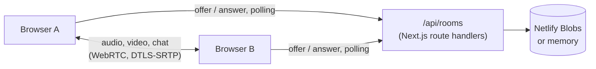

<div align="center">


# Convene

**Open-source video meetings that open in a browser tab. HD video, screen sharing, chat, reactions, waiting rooms and local recording, with no app, no account and no media server.**

[](LICENSE)
[](https://nextjs.org)
[](https://webrtc.org)

**Live:** <https://convene-meet.netlify.app>

</div>

Zoom, Webex and Teams need an app, an account, or both. Convene is a meeting link: start a meeting, send the
link, and everyone talks in their browser. It is free to use, change and host under the MIT License.

## Features

- **Video and audio**: up to 720p video, echo cancellation, noise suppression and automatic gain, with a
  connection-quality indicator on every tile.
- **Lobby**: preview your camera, watch your microphone level and pick your camera, microphone and speakers
  before you join.
- **Gallery and speaker views**: tiles keep their 16:9 shape at any window size; the person talking gets a
  green outline, and speaker view follows them. Pin anyone to keep them on the stage.
- **Screen sharing** that takes the stage for everyone, with the presenter's camera in the strip beside it.
- **Chat** with clickable links, **reactions**, and **raise hand**.
- **Host controls**: waiting room with admit, deny and admit all; mute one person or everyone; lower hands;
  remove someone; lock the meeting; end it for everyone.
- **Record to this computer**: every tile and every voice, mixed into a WebM file. Nothing is uploaded, and
  everyone sees a recording badge while it runs.
- Keyboard: **M** mutes, **V** toggles the camera.

## How it works



- **Media is peer to peer.** Every participant connects directly to every other one (a mesh), so there is no
  media server to run or pay for. That suits meetings of up to about 8 people.
- **Signalling is plain HTTP.** Serverless functions can't hold WebSockets, so each participant polls an
  inbox in the room: fast while a call is being set up, every two seconds once it is steady. Each message is
  its own key in the store, so concurrent writers never overwrite each other, and messages are deleted only
  after the client acknowledges them.
- **One fixed connection layout.** The participant who joined later makes the offer, with three slots
  (microphone, camera, screen) and a data channel. Turning the camera off or starting a share only swaps
  tracks, so a call never renegotiates once it is up. ICE candidates ride inside the offer and answer, so
  setting up a connection takes one message each way.
- **Hosts are enforced on the server.** Creating a meeting returns a host key (kept in the creator's
  browser); every participant gets a secret token. The waiting room, removal, locking and ending are checked
  server-side, not just hidden in the UI.

## Run it

```bash
git clone https://github.com/amanjhacodes55/convene.git
cd convene
npm install
npm run dev        # http://localhost:3000
```

Locally, meetings live in memory, which is right for one `next start` process.

**Deploy to Netlify:** connect the repository or run `netlify deploy --build --prod`. Netlify detects Next.js,
and Convene stores meetings in [Netlify Blobs](https://docs.netlify.com/blobs/overview/), which every site has,
so there is nothing to configure.

For networks that block direct connections, add a TURN server with `TURN_URLS`, `TURN_USERNAME` and
`TURN_CREDENTIAL` (see [.env.example](.env.example)).

## Development

```bash
npm test           # room logic: joining, signalling order, waiting room, host controls
npm run lint
npm run typecheck
npm run build && npx next start -p 3020 &
BASE=http://localhost:3020 npm run e2e   # real browsers in a real call, through the UI
```

The end-to-end test drives Chrome with fake cameras: a host starts a meeting, a guest joins and both see
video, chat and mute state cross over, a screen share takes the stage, a newcomer is held in the waiting
room until admitted, and the host ends the meeting for everyone.

## License

[MIT](LICENSE)
