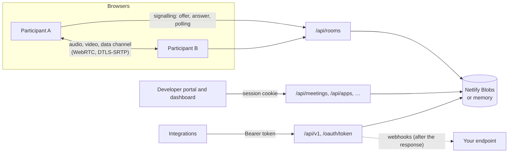

# Architecture

Convene is one Next.js app. Pages are React; the server is route handlers backed by a small key-value store.

## Calls

- **Media is peer to peer** in a full mesh: every participant connects to every other one, so there is no
  media server. That suits meetings of up to about 8 people.
- **Signalling is HTTP polling**, because serverless functions can't hold WebSockets. Each participant has an
  inbox in the store; each message is its own key, so concurrent writers never collide, and messages are
  deleted only once acknowledged. Polling is quick while a call is being set up and every two seconds after.
- **One fixed connection layout**: the participant who joined later offers three transceivers (microphone,
  camera, screen) and a data channel. Muting, turning the camera off and sharing only swap tracks, so a call
  never renegotiates. ICE candidates ride inside the offer and answer.
- **The data channel** carries chat (including private messages), reactions, raised hands, mute state,
  spotlight, captions and recording notices. Messages that apps post through the API arrive through the
  server inbox instead.
- **Live captions** use the Web Speech API in each speaker's own browser, which transcribes their microphone
  while anyone in the call has captions on, and sends the text over the data channel.
- **Recording** draws every tile onto a canvas, mixes every voice with Web Audio, and saves a WebM file
  locally with MediaRecorder.

## Accounts and the platform

- **Accounts are optional.** Passwords are scrypt hashes. Sessions are random tokens in an HttpOnly,
  SameSite=Lax cookie, stored as SHA-256 hashes; endpoints that use the cookie also check `Origin`.
- **Meetings can have an owner**, who is their host on any device. Guests' meetings, started from the home
  page, have no owner; the creator's browser keeps a host key instead.
- **OAuth** (`src/lib/oauth.ts`): apps, client secrets, authorization codes and tokens are all stored only as
  SHA-256 hashes. Each user's authorization of an app is a *grant* with an id; tokens carry that id, so
  removing the grant, deleting the app, or replaying a code invalidates them at once.
- **Webhooks** (`src/lib/webhooks.ts`): room events (`src/lib/rooms.ts`) find the apps listening for the
  meeting's owner and deliver signed requests from Next.js `after()`, once the response is sent.
- **One catalog** (`src/lib/catalog.ts`) lists scopes, events and endpoints; the server enforces it and the
  portal, playground and docs render it.

## Store keys

| Key | Holds |
| --- | --- |
| `rooms/<code>/meta` | A meeting: title, settings, owner, schedule, start and end |
| `rooms/<code>/peers/<id>` | A participant and their hashed token |
| `rooms/<code>/inbox/<to>/…` | Signalling and server messages for one participant |
| `rooms/<code>/attendance/<id>` | When someone joined and left |
| `users/<id>`, `emails/<email>`, `sessions/<hash>` | Accounts and sessions |
| `users/<id>/meetings/<code>`, `users/<id>/apps/<id>`, `users/<id>/grants/<appId>` | An account's indexes |
| `apps/<id>`, `clients/<client_id>` | Apps |
| `oauth/codes/<hash>`, `oauth/tokens/<hash>` | Authorization codes, access and refresh tokens |
| `apps/<id>/deliveries/…`, `bins/<id>/req/…` | Webhook delivery log and test inboxes |
